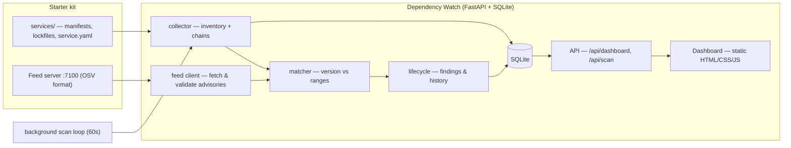
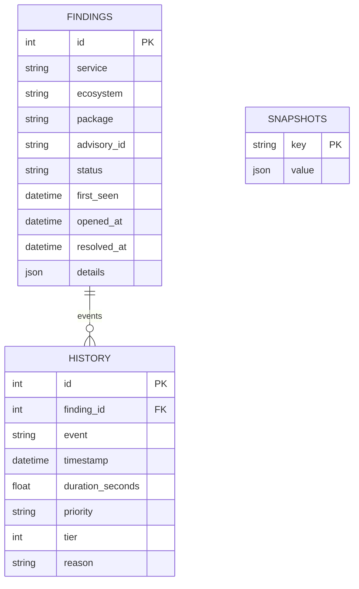
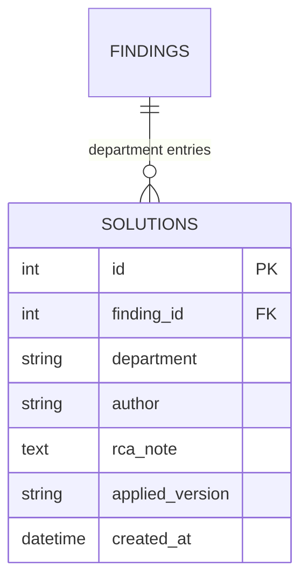

# Dependency Watch — Design

**Updated:** 18 Nov 2026 · Describes the implementation in [`watcher/`](watcher/README.md) and the next phase in [`PLAN.md`](PLAN.md) §7/§12.

## 1. Purpose

Answer, for eight independent services: which dependency versions are exposed to which OSV advisories, how urgent each exposure is, why it exists (which chain pulled it in), and how long similar issues took to resolve. Detection and impact are the product. The owning department records the solution by hand; notifications and developer assignment are extras.

## 2. Architecture

Single deployable Python app — modular monolith, no queues or extra services.



| Module | File | Responsibility |
| --- | --- | --- |
| Collector | `watcher/collect.py` | Parse `service.yaml`, npm lockfile v3, requirements files; direct/transitive, prod/dev, `required_by` chains |
| Engine | `watcher/engine.py` | Advisory fetch/validation, range matching, risk scoring, lifecycle persistence, estimates |
| API | `watcher/app.py` | FastAPI routes, static mount, background scan loop (`SCAN_INTERVAL`, default 60 s) |
| UI | `watcher/static/` | Vanilla HTML/CSS/JS; client-side rendering; 15 s polling |

## 3. Scan pipeline

1. Collect inventory from `services/` (or accept injected data in tests).
2. Fetch `/v1/advisories` (validate: list of dicts, `id`, `affected[]`, package name/ecosystem present). In `FEED_MODE=auto`, an unreachable or unparseable live response falls back to the kit's bundled feed and records `feed_source=bundled` + a warning; validation failures abort the scan. `FEED_MODE=live` disables the fallback; `FEED_MODE=bundled` reads the fixture directly.
3. For each service × dependency × advisory × affected entry: normalize names (PyPI: `_`/`.`/`-` collapsed, case-insensitive), evaluate version against ranges.
4. Build finding details: versions, chains, fixed versions, severity, priority + reason.
5. Upsert in one transaction: new → `OPEN` + `NEW` event; resolved → `REOPENED` + event; open → refresh details.
6. Resolve absent findings only when evidence supports it (service present, lockfile present, advisory present).
7. Store the last successful snapshot (`inventory`, `advisories`, `feed`, `uncertain`).

**Failure semantics:** validation errors, collection errors and, in `FEED_MODE=live`, fetch errors abort before writing; the last snapshot and lifecycle remain untouched and `error` is surfaced in the API. In `auto` mode a fetch/parse failure is not a failed scan: the bundled advisories are used and the snapshot says so (`feed_source`, `feed_warning`).

## 4. Matching semantics

| Ecosystem | Range type | Comparison |
| --- | --- | --- |
| npm | `SEMVER` | `semantic_version.Version`, event walk (`introduced`/`fixed`/`last_affected`) |
| PyPI | `ECOSYSTEM` | `packaging.version.Version` |

- A version-only comparison; ranges with unsupported types make the result **unknown**, never "safe".
- `None` (no installed version) or unparseable versions → unknown; unknown findings are held, never resolved.
- Overlapping/adjacent ranges are handled per OSV semantics; boundaries tested (`fixed` itself is not affected).
- Withdrawn advisories are skipped at match time; an existing finding then resolves with reason `withdrawn`.

## 5. Risk scoring

```
level  = LOW 0 · MODERATE 1 · HIGH 2 · CRITICAL 3 · UNKNOWN 2
score  = level + (3 − tier) + internet_facing (0/1)
band   = P0 if score ≥ 5, P1 if score ≥ 3, else P2
reason = "<severity>; tier <n>; internet-facing|not; exploitability unknown"
```

Tier and exposure come from `service.yaml`; exploitability is absent from the feed and is therefore never claimed.

## 6. Data model

### Shipped



- `findings` is unique on `(service, ecosystem, package, advisory_id)`; reference shown as `DW-F-{id:06d}`.
- `status`: `OPEN` | `RESOLVED` | `REOPENED`. Reopen reuses the row (same reference), resets `opened_at`, keeps prior `HISTORY`.
- `details` (JSON): service metadata snapshot, normalized package, advisory summary, severity, priority, reason, vulnerable versions, chains, fixed versions.
- `history.reason`: `withdrawn`, `advisory changed`, or `dependency changed`. Only the last feeds the estimate cohort.
- `snapshots`: last successful `inventory`, `advisories`, `last_scan`, `feed`, `feed_source` (`live`/`bundled`/`injected`), `feed_warning`, `uncertain` count/keys.

### Planned (dashboard phase, PLAN §12.1–12.2)

`last_detected_at` on findings; `version_observations`; `advisory_snapshots`; **`solutions`** (department-entered solution records — see below); severity/priority captured on every event. Migration preserves IDs and existing rows; no synthetic backfill.

`solutions` is append-only and never written by the scanner:



A solution entry records what the department says it did. It does not change `findings.status`; only a rescan that no longer detects the vulnerable version resolves the finding. Corrections are new entries, never edits, so earlier statements remain visible.

## 7. API contract

| Endpoint | Returns |
| --- | --- |
| `GET /` | Dashboard HTML |
| `GET /health` | `{status, scan_status, feed_status, last_scan, feed, feed_source, warning, error}` — always `200`; never scans |
| `GET /api/dashboard` | `{inventory, advisories, last_scan, feed, feed_source, feed_warning, uncertain, uncertain_keys, findings[], error, health}` — `health` mirrors `/health` |
| `POST /api/scan` | Scan summary `{last_scan, matches, uncertain}`; `503` with detail on failure |
| `GET /api/findings/{reference}` | One finding + `solutions[]` (planned) |
| `POST /api/findings/{reference}/solutions` | Appends a department-entered solution (`author`, `rca_note`, `applied_version`); returns the updated finding (planned) |

Each finding in `findings[]`: `id`, `reference`, `status`, `service`, `owner`, `tier`, `internet_facing`, `ecosystem`, `package`, `versions[]`, `advisory_id`, `summary`, `severity`, `priority`, `reason`, `chains[][]`, `fixed_versions[]`, `first_seen`, `opened_at`, `resolved_at`, `history[]`, `solutions[]`, `expected_seconds`, `estimate_samples`, `elapsed_seconds`, `overdue`, `verification_uncertain`.

`/health` keeps scan health and feed health separate:

| Field | Values | Meaning |
| --- | --- | --- |
| `scan_status` | `none` · `ok` · `failed` | Latest scan attempt; `none` before the first attempt |
| `feed_status` | `live` · `fallback` · `unavailable` | Where the advisories came from in the latest attempt |
| `status` | `starting` · `ok` · `degraded` | `starting` = no successful scan; `ok` = successful scan + live feed; `degraded` = fallback feed or a failed latest scan |

A scan failure caused by an unreachable feed reports `scan_status: failed` and `feed_status: unavailable`; a validation failure after a successful live fetch reports `failed` with `feed_status: live`. The endpoint only reads persisted snapshots and in-process state — it never triggers collection or matching.

Planned: history list with pagination, analytics aggregates, dependency graph endpoint.

## 8. Frontend

- Serverless build: Flask/FastAPI serves three static files; JS renders from `/api/dashboard` every 15 s.
- All interpolated text is HTML-escaped (`esc()`); no third-party scripts.
- Current views: Findings, Services, Vulnerabilities (tabs). Target IA: sidebar with Overview, Current vulnerabilities, Investigation, History, Impact, Resolution time, Analytics (PLAN §7).
- The header shows health pills (overall, feed, scan) sourced from the embedded `health` payload; the notice bar explains fallback and failure states.
- Findings support search plus status, priority, severity and sort controls; severity stat cards act as filters. Open rows survive the 15 s refresh.
- Services are sorted by active findings, show their highest severity and unknown-version count, and link into the matching finding. Advisories are sorted by severity and expose ranges, fixed versions and affected services.
- The Investigation view carries the **solution entry form** (author, RCA note, applied version); submitted entries are rendered from the API, not from local state. (Not built yet — PLAN §12.2.)
- Empty/unknown states are explicit — no placeholder data. A finding with no recorded solution says "No solution recorded", never "Fix: …".

## 9. Accuracy and safety principles

1. **No fabricated data.** Missing CVSS/root cause/exploit text renders as "Not available".
2. **Unknown ≠ safe.** Unknown versions block both matching and resolution.
3. **Evidence before resolution.** A finding resolves only when the service and lockfile are present and the advisory is known; withdrawn advisories resolve as `withdrawn`, not as fixes.
4. **Estimates are estimates.** Median of ≥3 historical resolutions in the same priority/tier, labelled with sample count; never a deadline.
5. **Fixtures are read-only.** `services/` is never edited; simulations use `scripts/change.sh`.
6. **Solutions are recorded, not generated.** The owning department writes the RCA and the version it applied; the system never invents a solution from a version bump or the feed's fixed range.
7. **Proposals, not deployments.** Automated updates stop at a proposed change for human review; a proposal does not create a solution record.
8. **Records are append-only.** Corrections are new solution entries; the original claim stays visible.
9. **Fallbacks are labelled.** The bundled kit feed is used only when the live feed is unavailable (or explicitly requested), and the snapshot says `feed_source: bundled` with a visible warning — it is never passed off as live.

## 10. Known limits

- Lockfile versions are evidence of resolution, not of production deployment.
- No service-to-service graph, no business workflow mapping, no traffic/load data.
- No SLA; "overdue" compares elapsed time to a historical estimate only.
- The app is local-only with no authentication and no multi-user state.
