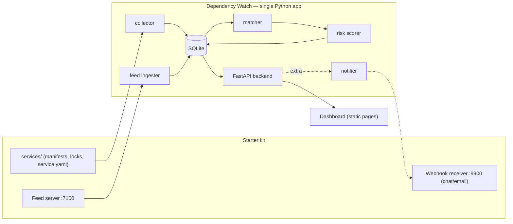
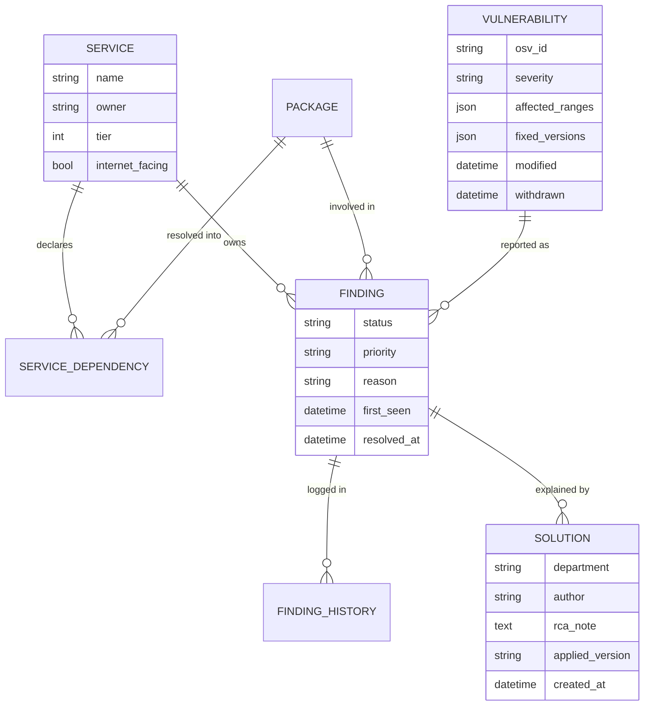

# Dependency Watch — Build Plan

**Acko buildathon · 6-hour timebox · v1 draft**

**Current phase (18 Nov):** the core engine and baseline dashboard are built (see `PROGRESS.md`). Next: the enterprise dashboard, the historical evidence store, and safe update *proposals* — §7, §12.

**Main goal:** monitor dependencies and find vulnerabilities across all 8 services — collect dependencies (npm + Python, direct and transitive, actual installed versions), regularly check the OSV feed, match versions against vulnerable ranges, identify affected services and their owning departments, show dependency chains, prioritize by severity/service importance/internet exposure, and track findings as new → resolved → reopened on a dashboard.

**Settled:** the department records the **solution manually** in the dashboard (RCA text, the version applied, who recorded it, when). The system never generates, guesses, or substitutes a solution — it only provides the evidence (advisory, ranges, chain, known fixed versions).

**Explicitly extra (built only if core is done):** notifications to departments and developer assignment.

Basis: the starter kit itself — `README.md`, all 8 `services/*/service.yaml`, the dependency file formats (`package-lock.json` v3, pip-compile `requirements.lock` with `# via` comments), and sample advisories from both feeds. **No research outside the kit has been performed.** Assumptions and open questions are marked in §11.

---

## 1. Problem understanding

Dependency Watch continuously answers: **which services are exposed to which vulnerable packages, how badly, and what to do about it.**

Each service is independent — own stack, owner, criticality tier, internet exposure — yet they share open-source packages, and packages depend on packages. So detection must cover **direct and transitive** dependencies, and prioritization must use real business context, not severity alone.

**What the kit actually gives us (verified):**

| Piece | Detail |
| --- | --- |
| 8 services | `services/`, each with `service.yaml` (name, owner, tier 1–3, `internet_facing`) |
| npm services | payments, quote, notifications, renewals — `package.json` + `package-lock.json` (v3) |
| PyPI services | claims, policy, kyc, docs-gen — `requirements.txt` + `requirements.lock` (pip-compile, `# via`) + optional `requirements-dev.txt` (kyc) |
| Mock OSV feed | `:7100`, OSV 1.6.0, ids `DW-2026-XXXX`; list / per-ecosystem / `modified_since` / single; switch feeds via `POST /control/feed/2` (adds, **changes**, and **withdraws** advisories — `withdrawn` confirmed in feed-2) |
| Severity | only `database_specific.severity`: LOW / MODERATE / HIGH / CRITICAL. No CVSS, no exploit data observed |
| Ranges | npm advisories use `SEMVER` ranges; PyPI advisories use `ECOSYSTEM` ranges — matcher must handle both |
| Webhook receiver | `:9900` stands in for chat + email; `GET /api/received` to verify delivery |
| Simulation | `scripts/change.sh` (fix/revert quote-axios, payments-jwt, reset) — use as acceptance harness |
| Rules | don't hand-edit `services/` or the feed; how DW reads service files is our decision |

## 2. Users & product principles

**Who uses Dependency Watch (provided by the builder):**

| User | What they do with it |
| --- | --- |
| **DevOps team** *(primary, core product)* | Monitors the whole fleet — vulnerabilities, affected services, overall risk, department roll-up, metrics |
| **Backend departments** — the `owner` in each `service.yaml` (Payments, Policy, Claims, Onboarding, …) | Shown as the **owning department** for every affected service. The department (or its developer) opens its findings, applies a fix, and **records the solution by hand** in the dashboard: RCA note, version applied, author, timestamp |
| **Developers (within a department)** | Investigate and fix; the recorded solution is attributed to the person who entered it |

Routing key: `owner` = the department. Every finding and vulnerability displays the owning department. Solution recording is a settled dashboard feature (manual entry, never auto-generated); sending alerts and assigning developers are extras, layered on top.

**Principles:**

1. **Understand the service before scoring its risk.** Inventory — owner, tier, exposure, stack — is stage 0, not an afterthought.
2. **No naked findings.** Every finding ships with a plain-language reason built from the factors that produced its priority — written for the senior engineer who has to decide in 30 seconds.
3. **Be honest about unknowns.** Unpinned dependencies (docs-gen-svc has no lock file and range-only specs) are surfaced as their own risk, not silently guessed.

## 3. Workflow stages

| # | Stage | Module | Core? |
| --- | --- | --- | --- |
| 1 | Service inventory (tier, owner, exposure, stack) | collector | ✅ |
| 2 | Dependency discovery — npm + Python, actual installed versions | collector | ✅ |
| 3 | Direct/transitive resolution (prod vs dev) | collector | ✅ |
| 4 | OSV feed ingestion — regular polls, `modified_since`, add/change/withdraw | feed ingester | ✅ |
| 5 | Version ↔ vulnerability matching (SEMVER + ECOSYSTEM) | matcher | ✅ |
| 6 | Affected-services mapping: per vulnerability → services, dependency chain, owning department | matcher + collector data | ✅ |
| 7 | Risk prioritization (severity, exploitability-if-data, tier, internet exposure) | risk scorer | ✅ |
| 8 | Lifecycle tracking: new → resolved → reopened (auto-detected by rescans) | findings logic | ✅ |
| 9 | Fix-time estimation from resolution history; expected fix time + overdue flags | findings logic (statistics) | ✅ |
| 10 | Dashboard: vulnerabilities, affected services, overall risk + metrics | API + UI | ✅ |
| 11 | Solution record entered manually by the owning department (RCA, applied version, author, timestamp); fix still verified by rescan | findings logic + UI | ✅ dashboard phase |
| 12 | Notifications to departments; developer assignment | notifier + UI | 🔶 extra |

Existing starting point: `watcher/collect.py` (prep work from earlier session) already implements stages 1–3 and emits `inventory.json` — reuse it, don't rebuild.

**The real-time loop, honestly.** The kit has no push source, so "real-time" means a short poll cycle (~30–60 s: feed `modified_since` + dependency rescan) driving the core loop **detect → prioritize → track (new/resolved/reopened) → display**. Every state change is visible on the dashboard within one cycle; `scripts/change.sh fix-*` simulates a team's fix and the follow-up rescan auto-resolves the finding. No simulated push infrastructure.

## 4. Intelligent risk prioritization

Factors: **severity** (feed), **service criticality** (tier 1–3), **internet exposure**, **exploitability** (only when reliable data exists — none observed in the kit's advisories, §11), plus reachability refinements: **direct vs transitive**, **prod vs dev scope**. Goal: critical issues get attention first, with every priority backed by an understandable reason.

Proposed starting bands (tune with the product owner):

| Priority | Banding | Meaning |
| --- | --- | --- |
| P0 | tier 1 + internet-facing + HIGH/CRITICAL | fix now |
| P1 | tier 1 internal, or tier 2 internet-facing | fix today |
| P2 | everything else | ticket / digest |

Dev-scope findings are capped at P2 pending product-owner confirmation. Every finding stores a generated `reason` string, e.g. *"Tier-1 internet-facing payments-svc, CRITICAL advisory, direct dependency."*

**Fleet cascade factor.** The goal behind traffic-aware prioritization is reducing cross-service failure. The kit provides no traffic or call-graph data (§11), but one cascade signal *is* derivable from our inventory: **shared vulnerable packages**. When the same package is vulnerable in many services at once — especially tier-1 ones — a single advisory is a fleet-wide risk, so the overview shows a cascade flag: *"package X affects N services (M tier-1)"*. This raises visibility for DevOps; it does not change the per-finding band.

**Traffic/load factor as a designed-in extension.** The risk scorer accepts an optional per-service load input; absent real data it stays neutral, and the fallback ordering is the severity-based banding above (already least→most severe per service). If genuine traffic data becomes available (product owner to confirm, §11), high-load services tighten one priority band without rework — the hook exists, and no fake telemetry is invented for the demo.

**Historical fix-time analysis.** Every finding already records its full life (detected → resolved → reopened) with timestamps, so the history needed for fix-time analysis is free to collect — no new data source:

- **Elapsed-time tracking:** each open finding shows how long it has been unresolved.
- **Expected fix time for new findings:** estimated from actual historical resolutions — the median time-to-resolution of past findings in the same band (priority × tier), shown on each new finding.
- **Overdue detection:** an open finding older than its expected fix time (or the tier SLA, §11) is flagged overdue on the overview.
- **Recurring-delay signal:** per-service and per-department averages of time-to-resolution, so patterns ("Payments always takes long on HIGH findings") are visible.
- **Method for the buildathon:** pure statistics over `FINDING_HISTORY` (median/percentile per band) — no ML. ML-based estimation is explicitly deferred until enough resolved findings exist (tens, not hundreds); the design just needs the history data, which core already produces. This keeps the primary focus on dependency monitoring, detection, and impact analysis.

## 5. Architecture (proposed)

**One modular monolith, one language, zero infrastructure.** Python 3 + FastAPI; SQLite for storage; static HTML/JS dashboard served by the same app; a plain loop (or manual "scan now" endpoint) instead of a scheduler. Rationale: 6 hours, 8 services, ~40 deps — everything a framework buys us here is overhead. Avoid microservices, queues, and auth entirely.

- **collector** — parses `service.yaml` + manifest/lock files into normalized deps (already prototyped).
- **feed ingester** — full sync on start, then `modified_since` polls; re-syncs fully when `GET /control/state` shows a feed switch; applies `withdrawn` advisories.
- **matcher** — evaluates installed versions against OSV `SEMVER` (npm) and `ECOSYSTEM` (PyPI) ranges; upserts by advisory id to stay duplicate-free.
- **risk scorer** — computes priority + reason string per finding.
- **notifier** *(extra)* — posts alerts to the webhook receiver (the chat/email stand-in), addressed to the **department** from `service.yaml` → `owner`. Payload carries the evidence needed to act: affected service, vulnerable dependency, severity, **dependency chain** (the `required_by` path), priority, and the known fixed version from the advisory (if any). Chat for P0/P1, digest for P2; DevOps gets fleet-level escalations (any P0, overdue). Built only after the core loop is complete.

**Solution recording (dashboard phase, manual by design):** a department opens a finding and records what it actually did — RCA note, the version applied (free text, e.g. `axios 1.6.0`), author name, timestamp. Entries are append-only and shown on the investigation and history views. The system never writes a solution, never infers one from a version bump, and never marks the record as verified; verification remains the rescan's job.

**Extra module — department workflow *(built if time remains):*** assign a developer (free text) and notify the owning department. The verification gate stays strict if built: only a rescan that no longer detects the vulnerable version closes a finding.

## 6. Data model

The key distinction: a **Vulnerability** is the advisory (global, can affect many services); a **Finding** is the per-service instance `(service, package, vulnerability)` — the unit of triage, remediation, and metrics.

- `SERVICE_DEPENDENCY`: version/spec, scope (prod/dev), direct flag, required-by chain — the chain is displayed on findings and vulnerability details (core).
- `FINDING` *(core fields above)*: status is auto-tracked by rescans. *(Extension field if assignment is built: `assignee` free text.)*
- `FINDING_HISTORY`: every transition with timestamp — detection, resolution, reopen (plus assignment if the extra workflow is built). Powers MTTR and the reopen count.
- `SOLUTION`: append-only department entry — RCA text, the version actually applied, author, timestamp. Entered by hand on the Investigation view; never created by the scanner, never used as proof of a fix.
- **Core lifecycle:** OPEN → RESOLVED → REOPENED, all auto-detected: a rescan that no longer detects the vulnerable version resolves the finding; if the `(service, package, vulnerability)` triple reappears after a dependency change, the same finding reopens (history preserved) instead of creating a duplicate.
- **Assignment lifecycle** *(extra only):* ASSIGNED → (fix is applied) → resolved by the verifying rescan. There is no manual "mark fixed" state — the rescan is the only gate. MTTR stays measured to RESOLVED.
- **Advisory change rule:** on re-ingest, advisories are upserted by OSV id; changed ranges/severity re-evaluate existing findings.

## 7. Main screens (dashboard IA)

Sidebar navigation, one view per page, consistent cards and tables, severity colours, generous spacing. Built on the existing static frontend stack — no new build toolchain.

| View | Question it answers | Key content |
| --- | --- | --- |
| **Overview** | What is my exposure right now? | Total dependencies monitored; open findings; severity counts (Critical/High/Medium/Low); affected services; open vs resolved; overall dependency-health indicator |
| **Current vulnerabilities** | What needs triage now? | Table: finding ref (`DW-F-…`), advisory ID, package, installed version, affected range, fixed version, severity (CVSS only if a source provides it), detected-at, status, affected services. A row opens the Investigation view |
| **Investigation** | Why does this matter? | What the vulnerability is; affected package + ranges; dependency chain; affected services + owners; **known fixed versions from the advisory**; the **solution recorded by the department** (RCA, version applied, author, timestamp) and a form to add one. Technical root cause, exploit method and CVSS appear **only when the source provides them** — otherwise "Not available" |
| **History** | What happened before? | Resolved findings with first/last detected, resolution date, actual time taken, version before → after, status-change history, and the department-entered solution. Solutions are never auto-written or backfilled |
| **Impact analysis** | What is the blast radius? | Graph: service → direct dependency → transitive dependency, with owner, tier, exposure and severity. Rendered from real lockfile edges; never implies service-to-service calls |
| **Resolution time** | How urgent is it? | Elapsed time, estimated time (with sample count), fixed-version availability, and whether a solution has been recorded (link to it). Estimates are labelled as estimates; "deadline" only if an SLA is agreed (§11) |
| **Analytics** | What are the trends? | Detection trend, open vs resolved trend, severity distribution, average resolution time, most vulnerable packages, most exposed services. Filters: date, severity, package, service, status |

Counts must distinguish **unique advisories** from **service-level findings** (show both, labelled). Empty states explain "no history yet" instead of rendering fabricated numbers.

**Extra screen (only if the extras are built):** department queue with assign-developer and notification actions. (Recording the solution is not an extra — it is part of the Investigation view.)

## 8. Testing strategy

- **Unit:** version-range matching (semver incl. `^`/`~` declarations vs installed versions; PEP 440/ECOSYSTEM comparisons), risk banding, `# via` chain parsing, lockfile v3 parsing, fix-time estimator (median per band, overdue flag) on synthetic history.
- **Integration:** collector against the real `services/` tree; feed ingester against the live feed including a `POST /control/feed/2` switch (added / changed / **withdrawn** advisories).
- **Acceptance (core):** end-to-end with the provided harness — feed-2 switch → findings appear and the dashboard updates within one poll cycle; `change.sh fix-quote-axios` → affected findings auto-resolve; `reset` → the triple reappears and the same finding reopens with history intact. New vulnerability produces findings exactly once; withdrawn advisory closes its findings.
- **Acceptance (extras, if built):** notification reaches the webhook receiver addressed to the owning department with service, dependency, severity, and chain; assigned finding reaches VERIFIED only after a verifying rescan.
- **Explicitly required cases:** duplicate advisories (no double-counting on re-ingest) and newly introduced vulnerabilities.

## 9. Metrics

| Metric | Source |
| --- | --- |
| Open findings by priority | findings table |
| Overdue findings | findings + tier-based SLA (**proposed default, needs PO sign-off — see §11**) |
| Mean time to remediation (first seen → auto-resolved by rescan; solution record shown alongside, not used as proof) | finding history + recorded solutions |
| Expected fix time per new finding (median of same-band historical resolutions) | finding history |
| Recurring delay by department (median time-to-resolution vs fleet median) | finding history |
| Open findings by department (accountability view) | findings grouped by service `owner` |
| Affected services per vulnerability | findings grouped by vulnerability |
| Resolved vs reopened | finding history |
| Most vulnerable packages (by finding count) | findings grouped by package |
| Services with highest exposure (weighted by severity) | findings × service tier/exposure |
| Detection trend over time | finding NEW events + scan snapshots |

All shown on the overview and analytics views — the DevOps monitoring surface. Departments are visible throughout (every finding and vulnerability names its owning department); the owning department records its solution on the Investigation view, while notifications and assignment are extras. Analytics filters: date range, severity, package, service, status.

## 10. Scope management

**Core first (the main goal):** collect (npm + Python, direct + transitive, installed versions) → ingest OSV regularly → match ranges → map affected services + chains + owning departments → prioritize (severity, tier, internet exposure) → track new/resolved/reopened → fix-time estimation from resolution history → dashboard with overall risk. ⚠️ The authoritative mandatory list is in the problem statement, which is **not included in the kit** — verify against it before coding; this plan assumes the core loop is mandatory.

**Extras, only after core is demonstrably complete (in build order):** department notifier → developer assignment. Then: real-time load-based prioritization (no traffic data in the kit; the scorer's load-factor hook is built, feeding it real data waits on the product owner — §4, §11), advanced service monitoring, exploitability enrichment. (Solution recording is **not** an extra: it is part of the dashboard and is entered manually by the department.)

**6-hour schedule:**

| Time | Work |
| --- | --- |
| 0:00–0:45 | Project skeleton, SQLite schema, wire in existing collector |
| 0:45–1:45 | Feed ingester + matcher, with matching unit tests |
| 1:45–2:45 | Risk scorer, affected-services mapping (chain + department), dedupe/reopen logic |
| 2:45–3:45 | API endpoints (read-only + lifecycle) |
| 3:45–4:45 | Dashboard: overview + service detail (+ vulnerability detail if on track), incl. expected-fix-time & overdue display |
| 4:45–5:15 | Extras: department notifier, then developer assignment |
| 5:15–6:00 | End-to-end run: feed-2 switch + `change.sh` scenarios, bugfix, demo notes |

**Cut order if behind (extras go first):** notifier → developer-assignment actions → vulnerability detail polish → recurring-delay/department-average analysis (keep the basic expected-fix-time + overdue flag) → metrics beyond open-by-priority → dev-scope filtering polish. Never cut: dedupe/reopen logic, the lifecycle history, and manual solution entry — they power both the core tracking and the fix-time analysis.

**Dashboard phase (current, agreed next):** the core table/escalation logic above stays fixed; the dashboard and its evidence store are built around it — history additions and update automation are specified in §12, screens in §7. Build order: DB migration → API fields → overview → current vulnerabilities → investigation → history → resolution time → impact graph → analytics → update proposals.

## 11. Assumptions & open questions

**Assumptions (verify during build):**
- `database_specific.severity` is the only severity signal; no CVSS/KEV → exploitability stays out of scoring unless the feed proves otherwise.
- npm advisories always use SEMVER ranges, PyPI advisories always ECOSYSTEM ranges.
- Reading `services/` from disk is acceptable; upload mode is deferred (README leaves this to us).
- Dev-scope dependencies are scanned but deprioritized.
- Tier-based SLA proposal for "overdue" is ours, absent product-owner guidance.
- The buildathon starts with **no historical resolution data**: expected-fix-time shows "no history yet" until findings accumulate (the demo seeds it by running `change.sh` fix/revert cycles); estimation is statistical (median per band), not ML.
- No traffic/load or inter-service call-graph data exists in the kit; cascade risk is approximated via shared packages across services.
- The mock feed supplies summary, ranges and severity only: **no CVSS score, exploit method, or technical root cause** — the investigation view shows "Not available" unless a richer source is added.
- No service-to-service call graph or business-workflow mapping exists in the kit; impact is shown as service → package chains, never as inferred service calls.
- No SLA has been agreed: "deadlines" appear only as clearly-labelled historical estimates (≥3 samples), never as guarantees.
- Automated dependency updates are **proposals**: repository and CI access are external to the kit, and `services/` fixtures must not be hand-edited — `scripts/change.sh` simulates the update.
- If the live feed is unavailable, the dashboard may use the kit's bundled advisories, labelled as offline demo data; it is never presented as the live feed.

**Open questions for the product owner:**
1. What SLA per tier defines "overdue"?
2. *(Only if extras are built)* Channel per priority: which severities go to chat vs email vs digest?
3. For unpinned deps like docs-gen-svc, is flagging as risk enough, or should we assume worst-case exposure?
4. Are dev-scope findings required in the main list?
5. Do evaluators expect file upload as well as local reads?
6. Is any traffic/load or inter-service dependency data available (now, or in the problem statement) to activate the load factor?
7. Solution records have no authentication behind them in the kit: is a free-text author + owning department enough, and should entries be append-only (a correction is a new entry) rather than editable?

## 12. Dashboard phase: history storage & update automation

### 12.1 History storage additions

The database already persists findings, status events and the last successful snapshots. The dashboard needs more evidence (existing finding IDs preserved; no fabricated backfill — history starts when collection starts, earlier gaps stay "unknown"):

| Addition | Why |
| --- | --- |
| `last_detected_at` per finding | "Last detected" column; accurate detection trends |
| `version_observations` (finding, observed_at, version) | Previous → upgraded version history for resolved findings |
| `advisory_snapshots` (advisory_id, fetched_at, payload) | Investigation page keeps the advisory as known at the time, even if the feed later changes or withdraws it |
| `solutions` (finding, department, author, rca_note, applied_version, created_at) | **Manual entry by the department**: the owning team records its RCA and the solution it applied. Append-only; the system never generates or substitutes a solution |
| Event context (severity/priority at event time) | Historical charts; RESOLVED events already carry priority/tier/reason |

Rules: the migration preserves existing references; a failed scan never writes; withdrawn advisories and advisory range changes are recorded as distinct reasons, not as fixes.

### 12.2 Manual solution records (settled)

The department fixes the issue and records what it did. The system supplies evidence only.

| Field | Rule |
| --- | --- |
| `finding_reference` | Existing `DW-F-…`; the entry is attached to that finding |
| `department` | Taken from the finding's owning service; not free text |
| `author` | Free text (no auth in the kit; self-declared) |
| `rca_note` | What caused it and what was done; required, free text |
| `applied_version` | The version the department actually deployed, if applicable; free text, not validated against the feed |
| `created_at` | Server timestamp |

Rules: entries are **append-only** — a correction is a new entry, so the record of what was believed at the time survives; entries never change finding status (only a rescan that no longer detects the version resolves it); a solution is never auto-generated, guessed from a version bump, or marked verified. The Investigation view shows the form and the entries; History shows them alongside the resolution. API: `GET /api/findings/{reference}` returns `solutions[]`; `POST /api/findings/{reference}/solutions` appends one and returns the updated finding.

### 12.3 Safe update automation (proposal-first)

1. Detect vulnerable version → 2. choose a candidate fixed version from the advisory ranges → 3. locate the upgrade point (direct dependency, or the parent of a transitive one) → 4. generate a proposed manifest/lockfile change → 5. run tests + vulnerability rescan → 6. owning department reviews → 7. record old/new versions and outcome in history.

Guardrails: never auto-deploy; never hand-edit `services/` — simulate with `scripts/change.sh`; a feed-listed "fixed" version is a candidate, not proof of compatibility, and major-version jumps are called out explicitly; if no fixed version or compatibility is unknown, report "no safe automated update" instead of guessing. Real pull-request automation needs repository + CI access, which is outside the kit. A proposal is **not** a solution record: the department applies the fix and writes the solution entry itself.

### 12.4 Sequencing and cuts

DB migration (tests first) → API fields → overview → current vulnerabilities → investigation (incl. manual solution entry) → history → resolution time → impact graph → analytics → update proposals. If time runs short: cut analytics first, then the impact graph, then history polish; update automation stays recommendation-only and is never cut into auto-deploy.

---

*Prepared as a draft before build; revisit §4 banding and §11 answers before writing code. Core/extras split agreed with the builder: detection and tracking are the product; solution recording is a manual dashboard feature; notifications and developer assignment are enhancements.*
